# Cleaning Service Image Production Workflow

A reusable Codex skill for source-faithful cleaning website photography, Darwin image-production handovers, professional equipment references and before/after continuity. Local checkpoints preserve owner image assignments and reduce repeated analysis.

## What it does

- Extracts exact source HTML placeholders and both comparison sides into CSV, per-page JSON and prompt briefs.
- Creates human-readable page asset folders and a resumable state ledger.
- Keeps source files read-only, refuses protected directory access and detects source drift.
- Registers versioned assets, requires generation preflight evidence, separates review from owner approval and locks approved revisions.
- Supplies service-specific realism, equipment, pair continuity, inspiration and image SEO guidance.

This is a local workflow, not an image-generation API service or website redesign. The agent uses the built-in image tool. No system can guarantee an agent never ignores instructions; the CLI guards supported operations and records evidence, while visual judgments and approval records remain attestations that must be truthful.

## Install and run

Requires Python 3.10+ and BeautifulSoup:

```powershell
python -m pip install -r requirements.txt
python .agents/skills/cleaning-image-production/scripts/workflow.py init --source "D:\read-only-city-html" --output "C:\city-image-output" --city Darwin
python .agents/skills/cleaning-image-production/scripts/workflow.py status --output "C:\city-image-output"
python .agents/skills/cleaning-image-production/scripts/workflow.py next --output "C:\city-image-output"
```

The source parser reads exact top-level HTML files, `.ph` placeholders and the two `.ba-layer` sides of each pair. Adapt unsupported markup deliberately; do not claim arbitrary HTML support. Counts are source-derived, not fixed at 5/10/15 images per page.

Copy `.agents/skills/cleaning-image-production` to your Codex skill directory for global discovery, or use the repository's AGENTS.md in a new project task. Start with [HANDOVER_PROMPT.md](HANDOVER_PROMPT.md). Local project configuration belongs beside the repository and must not be committed.

```mermaid
flowchart LR
  S[Read-only source HTML] --> D[Slot datasheet and page prompts]
  D --> E[Task and equipment reference check]
  E --> G[Built-in image tool]
  G --> R[Versioned asset and provenance]
  R --> Q[Visual and pair review]
  Q --> A[Exact owner approval and lock]
  A --> H[Page image folders and handover]
  H --> I[Optional source-faithful HTML integration]
```



## Generation and approval

Run `preflight` with the actual equipment-check evidence before registering illustrative generated work. `register` takes `--provenance AI_ILLUSTRATIVE` or actual `OWNER_SUPPLIED`. Review uses a JSON checks file with `task_visible`, `service_correct`, `realistic`, `equipment_correct`, `scene_diverse`, `crop_readable`, `pair_continuity`, and `result_visible`. Non-applicable checks need reasons in review evidence. `approve` requires direct owner evidence for the exact reviewed revision; workflow approval is insufficient.

These commands validate evidence presence, states and hashes, not pixel truth or whether a claimed owner message really occurred. Verify image decoding and dimensions with actual tooling; inspect relevant crops and pairs before recording visual success. Do not treat image-generation return status as approval.

## Image SEO and provenance

Use descriptive service/section/role filenames and accurate alt text reflecting the produced image. Avoid keyword stuffing, mismatched extensions and invented customer-job descriptions. See [Google's image SEO guidance](https://developers.google.com/search/docs/appearance/google-images). No ranking guarantee is made.

Google Images and other search results are inspiration references, not reuse licences, proof of equipment geometry or evidence of owner jobs. Generated/materially edited work remains illustrative unless authentic job evidence supports stronger claims.

## Verification

```powershell
python -m unittest discover -s tests -v
```

Tests cover source boundaries, exact extraction/context, safe resume, source drift, approval locks, incomplete review and retry limits. Review [docs/design.md](docs/design.md), [docs/plan.md](docs/plan.md) and [docs/evaluation.md](docs/evaluation.md) for scope and recorded limitations.

## Privacy and scope

The repository contains generic workflow code and docs. Owner photographs, private source HTML, local configurations, tokens and customer data are excluded. GitHub publication of this workflow does not authorize deployment changes. No Vercel access is performed.
